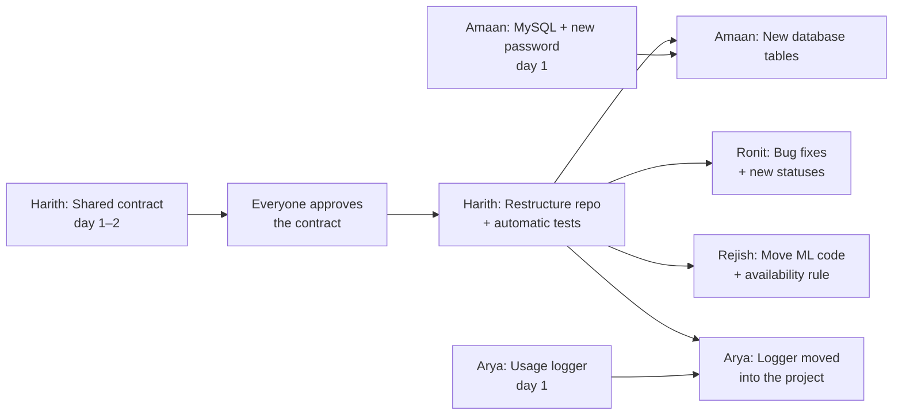

# Phase 0: Existing Code, What Changes, and Build Order

**Phase 0 (12–25 Oct) doesn't build the big features.** It reuses the code you already have, cleans it up, and gets the pieces ready to connect. It adds just **one new thing**: real laptop-usage logging. Task IDs (A-, H-, M-, R-, N-) refer to PRD §9.

---

## 1. What the existing code does today

Each person's folder works on its own, but **none of the pieces talk to each other**.

| Folder | What it does today | What's missing |
|---|---|---|
| **Arya_Work** (agent) | Every 5 s reads CPU, RAM, disk, network and seconds since the last keyboard/mouse touch (**Windows only**). Labels the laptop IDLE / BUSY / USER_ACTIVE. Sends a heartbeat to `localhost:5000`. 10 tests pass. | **Nothing receives the heartbeat** (no server exists). Saves nothing to disk, so no usage history. Mac/Linux detection doesn't work. |
| **Amaan_Work** (database) | A MySQL script with 2 tables (`nodes`, `jobs`). 3 Python functions: update a laptop, find an idle laptop, assign a job. | Laptops identified by IP (which changes on Wi-Fi). No usage-history table. **Password written in the code** (and on GitHub). |
| **Rejish_Work** (ML) | Generates 5,000 rows of **fake** usage data, trains a random-forest model, predicts idle minutes for a laptop. | No real data yet. Its input names don't match what Arya's agent sends. |
| **Ronit_Work** (executor, CLI, dashboard) | Packages a script into a zip, runs it, can pause/resume it, streams logs. CLI (`gridctl`) and a web dashboard. 3 demo jobs. 7 tests pass. | The dashboard shows **4 fake laptops**; every job runs on the same machine. Known bugs (demo runs twice; paused time counts towards the time limit; status display). |
| **Harith** (coordinator) | Nothing yet | The server that connects everything |

---

## 2. How Phase 0 is different from the existing code

| Person | Existing code | In Phase 0 | Kept or rewritten |
|---|---|---|---|
| **Arya** | Measures usage but throws it away; Windows only | **New:** a usage logger, built from his existing measuring code, that **saves a row every 15 s** to a file on every laptop. Mac + Linux idle detection added. Starts automatically at login. | **Kept** and extended |
| **Harith** | — | Writes the **shared contract** (one set of names for data, statuses and messages). Moves all four folders into **one project**. Sets up **automatic tests** on GitHub. Tests the network and sets up Tailscale. | New (organising work) |
| **Amaan** | 2 small tables, leaked password | Installs MySQL on the coordinator laptop and **changes the password**. **Rewrites the tables** (laptops identified by ID; new tables for usage history, job attempts, users and so on), created by a setup script. | Idea kept, tables **rewritten** |
| **Rejish** | Fake data → model | Moves his code into the new project. The fake-data generator becomes a **test tool only**. Writes the shared rule for "when is a laptop available?" Starts the related-work notes for the paper. | **Kept**; fake data no longer used for results |
| **Ronit** | Working executor, CLI and dashboard, with bugs | **Fixes the 3 known bugs.** Updates the CLI and dashboard to the new status names. No new features yet. | **Kept** and fixed |

**In one line:** existing code = 4 separate demos. **End of Phase 0** = one clean project, all tests passing, a ready database, and **real usage data piling up on every laptop**. The pieces are actually connected in Phase 1.

---

## 3. Build order for Phase 0

Two rules decide the order:
1. **The logger starts on day 1.** It depends on nobody, and every day it isn't running is lost training data.
2. **No one changes their folder's code until the contract is approved and the repo is restructured.** Both are Harith's jobs, and they unblock everyone else.

This assumes **Review 1 is on 14 Oct**: the demo is built on the *current* folders, and the restructure happens *after* the review so it can't break the demo.

### Step 1: Mon 12 – Tue 13 Oct (everyone starts, no waiting)

| Who | Do this |
|---|---|
| **Arya** | Usage logger using the CSV format in PRD Appendix D. **Running on all 5 laptops by Wed 14 Oct.** |
| **Amaan** | Install MySQL on the coordinator laptop; **change the leaked password** |
| **Harith** | Draft the shared contract; network test + Tailscale |
| **Harith + Ronit** | Review 1 demo: add a heartbeat endpoint to Ronit's current server so the dashboard shows real laptops |
| **Rejish** | Related-work notes; one chart from the first logged data for the demo |

### Step 2: Wed 14 Oct, Review 1

### Step 3: Thu 15 – Fri 16 Oct (blocking step)

| Who | Do this |
|---|---|
| **Everyone** | Read and approve the contract (all 5 approvals) |
| **Harith** | Restructure the repo into one project. **Code freeze: no one else pushes code during this.** |

### Step 4: Sat 17 – Sun 18 Oct

| Who | Do this |
|---|---|
| **Harith** | Automatic tests on GitHub (Windows, Mac, Linux) |
| **Arya** | Logger starts automatically at login on all 5 laptops |

### Step 5: Mon 19 – Sun 25 Oct (everyone in parallel)

| Who | Do this |
|---|---|
| **Amaan** | New database tables + setup script |
| **Ronit** | Fix the 3 bugs; new status names in the CLI and dashboard |
| **Rejish** | Move ML code; fake data for tests only; the availability rule |
| **Arya** | Move the logger into the project (`idlegrid-agent log-only`); **the CSV format must not change** |
| **Harith** | Fix any test failures; write up the network results |

> **If Review 1 is after 14 Oct:** do Step 3 (restructure) first, then build the demo on the new structure.

---

## 4. Phase 0 is done when

- [ ] The logger has run on all 5 laptops for more than a week, and restarts by itself after a reboot.
- [ ] One project: `pip install -e .[dev]` then `pytest` passes, with green tests on GitHub for all 3 operating systems.
- [ ] Database tables are created by the setup script; the old password no longer works.
- [ ] Ronit's 3 bugs are fixed, with tests that prove it.
- [ ] Network results are written down (campus Wi-Fi, home Wi-Fi, hotspot).
