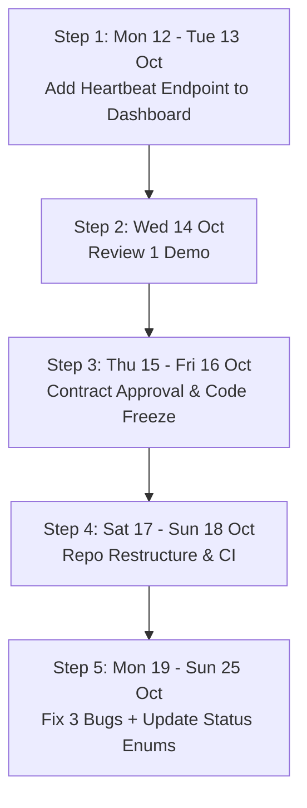

# Phase 0 Analysis & Implementation Report: Ronit (Role 5)

**Role:** Role 5 — Executor, Packager, CLI (`gridctl`) & Web Dashboard  
**Folder:** `Ronit_Work/`  
**Date:** October 2026  
**Reference Document:** `Phase0_Build_Order.md` (and PRD §9 / §10.5)

---

## 1. Executive Summary & Role Mission

In the Predictive Idle-Compute Scheduler architecture, **Ronit (Role 5)** owns the physical sandbox execution, job packaging, command-line interface (`gridctl`), and the web dashboard:
- **`src/packager/` (`bundle.py`)**: Packages python scripts, dependencies, manifests, and datasets into portable zip bundles; unpacks results and artifacts safely.
- **`src/executor/` (`runner.py`, `process_controller.py`)**: Spawns isolated job subprocesses, captures real-time stdout/stderr, and executes instant preemption (`suspend()`) and resumption (`resume()`) via `psutil`.
- **`src/cli/` (`gridctl.py`)**: Rich CLI client providing developer commands (`submit`, `status`, `logs`, `cluster`, `download`, `demo-run`).
- **`src/dashboard/` (`app.py`, `mock_cluster.py`, UI static files)**: Real-time telemetry, node cards, and demo management.

According to `Phase0_Build_Order.md`, Phase 0 (12–25 Oct) is about cleaning up, fixing known bugs, stabilizing contracts, and setting up the Review 1 demo bridge so pieces can connect in Phase 1.

---

## 2. Analysis of `Phase0_Build_Order.md` for Ronit

### 2.1 What the Existing Code Did vs What was Missing
| Component | Existing Code Today | What Was Missing / Broken |
|---|---|---|
| **Executor** | Runs scripts, suspends and resumes processes via `psutil`, streams stdout/stderr. | Paused time counted towards the execution timeout (R2); missing `TIMED_OUT` terminal state (R3). |
| **CLI (`gridctl`)** | Submits jobs, queries status, runs demo. | `demo-run` executed the script twice (R1); status formatter printed raw Enum representations like `JOBSTATUS.RUNNING` (R5). |
| **Dashboard** | Glassmorphic dark UI with live WebSocket telemetry. | Mocked 4 simulated laptops; had no endpoint to accept real node heartbeats from Arya's agent. |

### 2.2 Phase 0 Step-by-Step Schedule & Ronit's Deliverables



1. **Step 1 (Mon 12 – Tue 13 Oct) — Review 1 Demo Bridge:**
   - **Task:** Harith + Ronit: Add a heartbeat endpoint to Ronit's dashboard server (`POST /api/v1/heartbeat` and `GET /healthz`) so the dashboard displays real laptops running Arya's Node Agent.
2. **Step 2 (Wed 14 Oct) — Review 1:**
   - Demonstrate the working dashboard displaying real team laptops reporting heartbeats alongside simulated nodes.
3. **Step 3 (Thu 15 – Fri 16 Oct) — Shared Contract & Freeze:**
   - Approve shared contract (`idlegrid.common.models`). Code freeze during repository reorganization into a unified package.
4. **Step 4 (Sat 17 – Sun 18 Oct):**
   - CI and test setup across OS matrix.
5. **Step 5 (Mon 19 – Sun 25 Oct) — Parallel Implementation:**
   - Fix Ronit's 3 confirmed bugs (R1, R2/R3, R5) and update CLI/dashboard status names to the contract vocabulary.
6. **Exit Criteria:**
   - Ronit's 3 bugs are fixed, with regression tests that prove it.

---

## 3. Analysis & Resolution of the 3 Known Bugs

### 3.1 Bug 1 (R1): `gridctl demo-run` Runs the Compute Job Twice

- **Root Cause:**
  In `Ronit_Work/src/cli/gridctl.py`, `demo_run_cmd` invoked `runner.run_async()`, which spawned a background worker thread calling `runner.run_sync()`. After pausing and resuming, the code performed:
  ```python
  # Wait for completion
  if runner.controller:
      runner.controller.wait()
  res = runner.run_sync()  # BUG: Spawns a brand new ProcessController and executes script a 2nd time!
  ```
  `run_sync()` does not merely harvest results; it creates a new process and executes the job again synchronously.
- **The Fix:**
  Replaced the redundant `runner.run_sync()` call with `res = runner.wait() or runner.job_result`.
  `runner.wait()` waits for the already-running background execution thread to finish and returns the packaged result (`result_bundle.zip`). The job now executes **strictly once**.

---

### 3.2 Bug 2 (R2 & R3): Paused Time Counted Towards Time Limit & Missing `TIMED_OUT` Status

- **Root Cause:**
  In `Ronit_Work/src/executor/process_controller.py`, timeout detection was implemented as:
  ```python
  self._exit_code = self.process.wait(timeout=timeout)
  ```
  `subprocess.Popen.wait(timeout=...)` measures raw wall-clock time. If a job with a 60-second timeout was suspended for 65 seconds because the laptop owner was typing, the timeout expired during the pause, erroneously killing the job. Furthermore, the resulting status was set to generic `JobStatus.FAILED` instead of `TIMED_OUT`.
- **The Fix:**
  1. Implemented **active execution time tracking** using `time.monotonic()`:
     ```python
     def active_seconds(self) -> float:
         if self._started_monotonic is None:
             return 0.0
         now = time.monotonic()
         paused_now = (now - self._pause_start_monotonic) if self._is_paused and self._pause_start_monotonic else 0.0
         return max(0.0, (now - self._started_monotonic) - self._paused_total_monotonic - paused_now)
     ```
  2. Implemented active polling loop in `wait(timeout)` that only trips if `self.active_seconds() > timeout`.
  3. Added `JobStatus.TIMED_OUT = "TIMED_OUT"` to `src/common/models.py`.
  4. Updated `runner.py` and `process_controller.py` so that when active compute timeout is exceeded, the process terminates and the terminal status is set cleanly to `JobStatus.TIMED_OUT`.

---

### 3.3 Bug 3 (R5): Status Formatting & Phase 0 Contract Vocabulary

- **Root Cause:**
  In `Ronit_Work/src/cli/gridctl.py`, `format_status` did `status_str = str(status_str).upper()`. When passing a Python Enum object (e.g. `JobStatus.RUNNING`), stringification produced `"JOBSTATUS.RUNNING"`, which did not match the color map and rendered unstyled plain text.
  Additionally, Phase 0 introduced new contract statuses:
  - `JobStatus`: `TIMED_OUT`
  - `NodeStatus`: `RUNNING_JOB` (replacing `BUSY`), `HOST_BUSY`, `IDLE_RISKY`, `DRAINING`, `UNSCHEDULABLE`
- **The Fix:**
  1. Updated `format_status` and `format_node_status` to safely unpack Enum values:
     ```python
     val = getattr(status, "value", str(status))
     status_str = str(val).upper()
     if status_str.startswith("JOBSTATUS."):
         status_str = status_str.split(".", 1)[1]
     ```
  2. Added rich style mappings for all contract statuses:
     - `TIMED_OUT`: `⏰ TIMED_OUT` (bold red)
     - `RUNNING_JOB`: `⚡ RUNNING JOB` (bold cyan)
     - `HOST_BUSY`: `🟠 HOST BUSY` (bold yellow)
     - `IDLE_RISKY`: `🟡 IDLE (RISKY)` (bold yellow)
     - `DRAINING`: `🔶 DRAINING` (bold yellow)
     - `UNSCHEDULABLE`: `⛔ UNSCHEDULABLE` (bold red)
  3. Updated `src/dashboard/static/js/app.js` and `styles.css` with badges, pill classes (`.status-timed-out`, `.status-cancelled`), and card borders for all node and job states.

---

## 4. Review 1 Demo Bridge Implementation

To fulfill the Step 1 requirement ("Review 1 demo: add a heartbeat endpoint to Ronit's current server so the dashboard shows real laptops"):
1. **Liveness Check (`GET /healthz`):**
   Added in `src/dashboard/app.py` returning service identity, version, and active node count.
2. **Heartbeat Receiver (`POST /api/v1/heartbeat`):**
   Accepts Arya's Node Agent payload (`node_id`, `hostname`, `state`, `metrics`, `os`).
3. **State Mapping (`ClusterOrchestrator.register_heartbeat`):**
   - `USER_ACTIVE` / `ACTIVE` $\rightarrow$ `NodeStatus.HOST_ACTIVE`
   - `BUSY` $\rightarrow$ `NodeStatus.HOST_BUSY`
   - `IDLE` $\rightarrow$ `NodeStatus.IDLE_RISKY` (in Phase 0 before ML predictions exist)
   - `UNKNOWN` $\rightarrow$ `NodeStatus.UNSCHEDULABLE`
4. **Staleness Fail-Safe:**
   Real laptops that cease sending heartbeats for $> 15\text{ s}$ are automatically transitioned to `NodeStatus.OFFLINE`. Real laptops are excluded from synthetic random jitter.
5. **Dashboard UI Support:**
   Real laptops are marked with a `"💻 Live Team Laptop (<OS>)"` badge, disabling simulated mouse-click buttons intended for synthetic demo nodes.

---

## 5. Verification & Test Suite

All tests run locally in `Ronit_Work/` using `pytest`:

```text
============================= test session starts =============================
platform win32 -- Python 3.13.6, pytest-9.1.1
collected 12 items

tests/test_api.py::test_html_and_static_endpoints PASSED                 [  8%]
tests/test_api.py::test_cluster_nodes_and_preemption_toggle PASSED       [ 16%]
tests/test_api.py::test_job_submission_and_lifecycle PASSED              [ 25%]
tests/test_bundle.py::test_job_package_and_unpackage PASSED              [ 33%]
tests/test_bundle.py::test_result_package_and_unpackage PASSED           [ 41%]
tests/test_executor.py::test_job_runner_sync_execution PASSED            [ 50%]
tests/test_executor.py::test_job_preemption_pause_resume PASSED          [ 58%]
tests/test_phase0_fixes.py::test_r5_format_status_enum_and_string_values PASSED [ 66%]
tests/test_phase0_fixes.py::test_r2_active_timeout_ignores_paused_time PASSED [ 75%]
tests/test_phase0_fixes.py::test_r3_active_timeout_triggers_timed_out_status PASSED [ 83%]
tests/test_phase0_fixes.py::test_r1_demo_run_single_execution PASSED     [ 91%]
tests/test_phase0_fixes.py::test_review1_demo_bridge_endpoints PASSED    [100%]

======================== 12 passed, 1 warning in 9.52s ========================
```

### Summary of Completed Files (all inside `Ronit_Work/`):
- `Ronit_Work/src/common/models.py`: Updated with contract `JobStatus`, `NodeStatus`, and `NodeTelemetry` attributes.
- `Ronit_Work/src/executor/process_controller.py`: Active execution time tracking, monotonic pause recording, `TIMED_OUT` handling.
- `Ronit_Work/src/executor/runner.py`: Propagates `JobStatus.TIMED_OUT`, provides clean `wait()` result harvesting.
- `Ronit_Work/src/cli/gridctl.py`: Fixed R1 double-execution bug, fixed R5 enum formatting.
- `Ronit_Work/src/dashboard/app.py`: Added `GET /healthz` and `POST /api/v1/heartbeat`.
- `Ronit_Work/src/dashboard/mock_cluster.py`: Added `register_heartbeat` and `mark_stale_offline`.
- `Ronit_Work/src/dashboard/static/js/app.js`: Full UI support for all contract statuses and live team laptops.
- `Ronit_Work/src/dashboard/static/css/styles.css`: Badges, cards, and pill styles for all new statuses.
- `Ronit_Work/tests/test_phase0_fixes.py`: Comprehensive regression tests for R1, R2, R3, R5, and the demo bridge.
